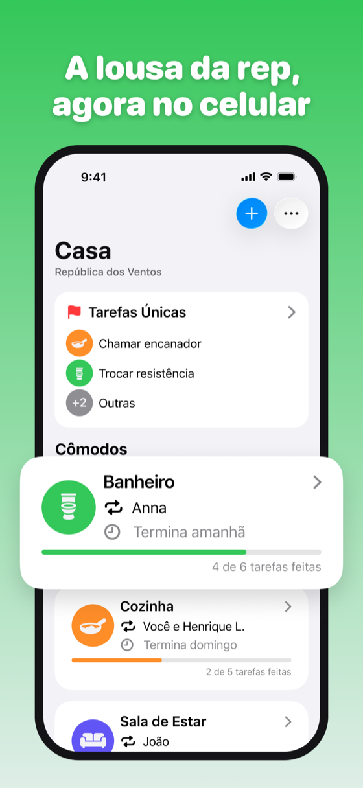
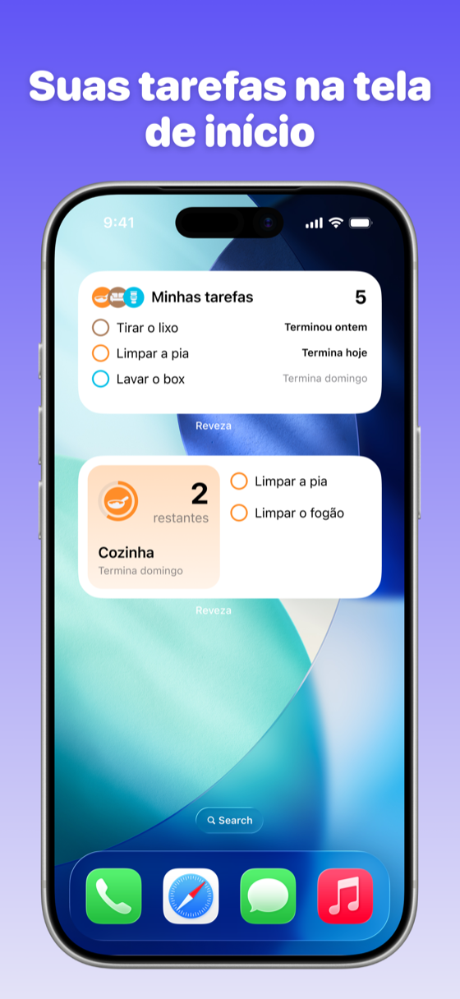

# Reveza

**Fair chore rotation for shared houses: a native iOS app, a serverless AWS backend and a WhatsApp assistant powered by Gemini.**


> Versão em português: [README.md](README.md). The technical docs in `docs/` are written in Brazilian Portuguese; this page summarizes them.

<p align="center">
  
  
  
</p>

## What it is

In Brazilian student houses (*repúblicas*) chores are often tracked on a whiteboard: someone has to remember to rotate the schedule, nobody knows who did how much, and the conversation turns into nagging. Reveza replaces the whiteboard with an algorithm: every cycle each room moves to a different person, the **effort** of each task is part of the math so the load stays balanced, and nobody has to chase anyone.

The app is **live on the App Store** (version 1.1 is released; 1.2, which adds an App Clip, was submitted for review on 2026-11-25). The UI is in Brazilian Portuguese and English.

## Features

- **Per-room rotation** with its own cycle (weekly, every 2 weeks, monthly…); tasks with their own recurrence use a rotating queue and a 2-day window counted from the last completion.
- **Effort-based fair distribution:** effort (1–3) is an internal load, never a score. The algorithm balances weekly load and keeps a fairness balance between housemates.
- **Task swaps**, **one-off tasks**, **weekly rating and summary** (aggregate only, never shows who rated), **vacation mode**, private and shared rooms.
- **WhatsApp assistant (Gemini):** link your number, ask for your tasks or a room's tasks, and complete a task after confirming with "yes".
- **Widgets**, **Siri and Shortcuts**, **Reminders sync**, daily reminders, an arrival-at-home notice (region monitoring, location stays on the device), **push notifications** (APNs) and an **App Clip**.

## Engineering highlights

- **Layered architecture with a pure domain.** SwiftUI + MVVM on Clean Architecture; the domain is a local Swift Package that only imports `Foundation`. The backend has the same domain in TypeScript with no `node:*`, no I/O and no global clock (`now` and `newID` are injected), enforced by a test.
- **One algorithm, two languages, cross-checked.** The Swift implementation is the reference; a generator runs scenarios on it and writes fixtures, and the TypeScript tests compare against them with `deepStrictEqual`, floating point included, across several time zones (including DST edge cases). A diverging fixture is a bug to investigate, never a tolerance to loosen.
- **Serverless backend with zero runtime dependencies.** `package.json` declares no `dependencies`: HMAC, SHA-256, JWT validation and the SigV4 S3 presigned URLs are hand-written on `node:crypto`; the AWS SDK v3 comes with the Lambda runtime. Five Lambdas (`api`, `webhook`, `worker`, `push`, `scheduled`) behind Function URLs, SQS FIFO, DynamoDB Streams and EventBridge. No API Gateway, no VPC. Infrastructure in Terraform.
- **Ports and adapters with contract tests.** The same contract suite runs against the in-memory adapter and the DynamoDB adapter (with a fake client).
- **Single-table DynamoDB with optimistic locking.** One partition per house, loaded with a single `Query`; each domain command runs on a copy and the diff is written in one `TransactWriteItems` conditioned on the house `version`, retrying on conflict. Uniqueness and idempotency are conditional writes.
- **Security and untrusted input.** Cognito JWT validated in the backend (RS256 only, access tokens only, `client_id` checked, fail-closed, 401 without a reason); the `userID` always comes from the token or the phone link, never from the request body or message text; signed webhook, idempotent worker, per-number rate limiting before any lookup or model call. The LLM only picks a read query; replies are built by code, and **completing a task is only written after the user's "yes", parsed by code**. No message content in logs; secrets only in AWS Secrets Manager.
- **Strict concurrency in Swift 6.** `SWIFT_STRICT_CONCURRENCY = complete`, `@MainActor` view models, no `Task.detached`, no `@unchecked Sendable` workarounds; schedule mutations run inside a copy/commit/rollback transaction.
- **Measured and optimized latency.** Production metrics showed the time was Lambda CPU growing with the house partition size, not DynamoDB or cold starts. Fixes: more memory for the `api` (p50 1.34 s → 0.61 s on a 155-call sample), publishing only each housemate's next turn, an aggregated `GET /v1/me/house/snapshot` route (Home screen 168 ms → 15 ms in the local benchmark), a short client cache and optimistic completion with per-row rollback. See [docs/LATENCIA.md](docs/LATENCIA.md).
- **Tests.** The backend has **1,277 tests** (`node:test`, 63 files), all passing: unit, port contracts, Swift reference fixtures and architecture tests. The app and the domain have their own Swift Testing suites. Roughly 30k lines of Swift and 14k lines of production TypeScript, plus 12k lines of TypeScript tests.

## The algorithm

Cost = squared weekly load (penalizes peaks) + effort concentration + amortized fairness balance, over a 12-week horizon. A Hungarian-algorithm assignment per queue (O(K³)) plus a local search across the house (up to 20 passes) when someone joins or leaves. It does not claim a global optimum, and the contract says so. Fairness: completing effort `E` in a room with `M` eligible people credits the doer `E − E/M` and debits the others `E/M`. Deterministic: same data and calendar give the same result, with explicit UUID tie-breaks. Full contract: [docs/ALGORITMO.md](docs/ALGORITMO.md).

## Architecture

The architecture diagram is in the [Portuguese README](README.md#arquitetura). In short: the iOS app talks over HTTPS with a Cognito access token to the `api` Lambda; WhatsApp messages go through a signed webhook Lambda into an SQS FIFO queue, then a worker Lambda that asks Gemini to pick a read query and answers through the Graph API; both use the same domain and the same single DynamoDB table; DynamoDB Streams and EventBridge drive APNs push notifications. The backend currently runs in a single AWS environment (`dev`) that serves the published app; a separate `prod` environment doesn't exist yet.

## Running

Backend and tests run fully locally, with no AWS, Meta or Gemini access:

```sh
swift test --package-path grupuxo/Packages/GrupuxoDomain

cd backend
npm install
npm run typecheck
npm test
npm run build
```

The app (`grupuxo/grupuxo.xcodeproj`, scheme `grupuxo`) talks to the `dev` API, which requires an account in that environment's Cognito pool; copy `grupuxo/Config/Local.xcconfig.example` to `Local.xcconfig` to point it at another server.

## Docs

[Product](docs/PRODUTO.md) · [Architecture](docs/ARQUITETURA.md) · [Algorithm](docs/ALGORITMO.md) · [Backend](docs/BACKEND.md) · [Design](docs/DESIGN.md) · [Latency](docs/LATENCIA.md) · [Infra](backend/infra/README.md)

## Author

Built by **Henrique Lacerda** ([@Henriquelacerdas](https://github.com/Henriquelacerdas)). Product and interface design: Letícia, at the Apple Developer Academy. Developed with the help of AI assistants (Claude Code); working rules in [CLAUDE.md](CLAUDE.md).
