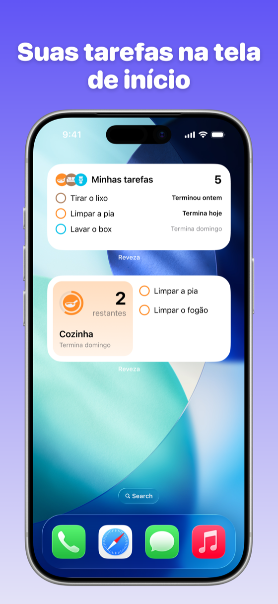
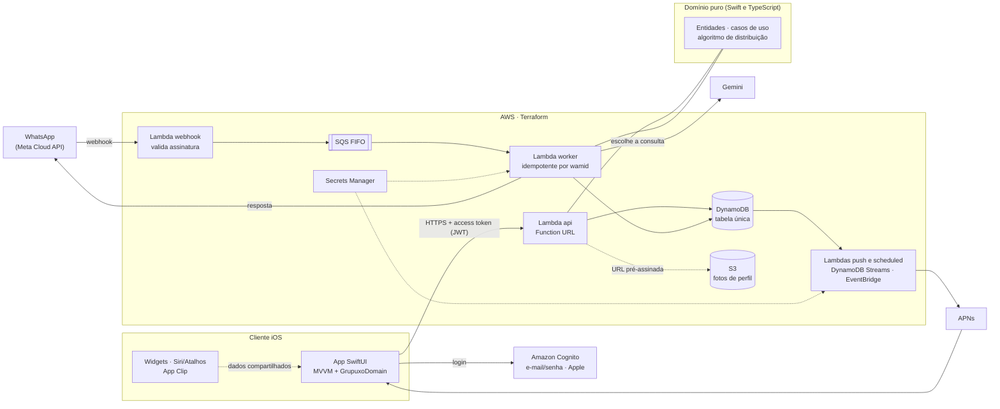

# Reveza

**Rodízio justo de tarefas domésticas para repúblicas e casas compartilhadas: app iOS nativo, backend serverless na AWS e um assistente de WhatsApp com Gemini.**


> English summary: [README.en.md](README.en.md). A documentação técnica em `docs/` está em português.

<p align="center">
  
  
  
</p>

## O problema

Em república, a divisão de tarefas costuma viver numa lousa: alguém precisa lembrar de girar a escala, ninguém se lembra de quanto cada um já fez e a conversa vira cobrança. O Reveza troca a lousa por um algoritmo: a cada ciclo cada cômodo passa para outra pessoa, o **esforço** de cada tarefa entra na conta para que a carga fique equilibrada, e ninguém precisa cobrar ninguém.

O app está **publicado na App Store** (versão 1.1 no ar; a 1.2, com App Clip, foi enviada para revisão em 25/11/2026).

## Funcionalidades

- **Rodízio por cômodo.** Cada cômodo tem seu ciclo (semanal, a cada 2 semanas, mensal…) e passa de pessoa em pessoa. Tarefas de **repetição própria** têm fila rotativa e janela de 2 dias contada a partir da última conclusão.
- **Distribuição justa por esforço.** Esforço de 1 a 3 é carga interna (nunca vira pontuação). O algoritmo equilibra a carga semanal e mantém um saldo de justiça entre os moradores ([como funciona](#o-algoritmo)).
- **Trocas de tarefa** entre moradores, com pedido, aceite ou recusa e notificação.
- **Tarefas únicas** (esporádicas): qualquer um pega, quem conclui pula a vez na próxima tarefa de repetição própria.
- **Avaliar a semana e Resumo da semana:** cada morador avalia os cômodos de que não cuidou, em três níveis e com tags opcionais de um catálogo fixo; o resultado é só um agregado, sem nomes.
- **Assistente no WhatsApp (Gemini).** O morador vincula o número e pergunta pelas próprias tarefas, pelas de um cômodo ou pelas únicas, e conclui uma tarefa depois de confirmar com "sim".
- **Widgets** de Minhas tarefas e de um cômodo, **Siri e Atalhos** (ver, abrir, criar e concluir tarefas), **sincronização com o app Lembretes**, **lembretes diários**, aviso **ao chegar em casa** (monitoramento de região, com a localização só no aparelho) e **push** (APNs) para virada de ciclo, trocas e resumo da semana.
- **App Clip** que apresenta o app e leva à versão completa.
- **Modo férias**, casas com vários cômodos comuns e privados, foto de perfil, login com e-mail e senha ou Sign in with Apple.
- **Português do Brasil e inglês**, seguindo o idioma do aparelho (String Catalog).

## Destaques de engenharia

**Arquitetura em camadas com domínio puro.** App SwiftUI com MVVM sobre Clean Architecture: `Domain` (entidades, casos de uso, algoritmos) → `Data` (repositórios remotos e mocks) → `Presentation`. O domínio vive num Swift Package local (`GrupuxoDomain`) que só importa `Foundation`. No backend, `src/domain/` é o mesmo domínio em TypeScript, sem `node:*`, sem I/O e sem relógio global: `now` e `newID` são injetados, e um teste verifica que o domínio não importa `node:*`.

**Um algoritmo, duas linguagens, verificação cruzada.** O algoritmo nasceu em Swift e foi portado para TypeScript para rodar no servidor. O gerador `backend/tools/swift-fixtures` executa cenários no `GrupuxoDomain` e grava os resultados como fixtures; os testes do TypeScript comparam com `deepStrictEqual`, incluindo o ponto flutuante bit a bit e um calendário testado em vários fusos (inclusive a meia-noite inexistente de 2018 em São Paulo e Lord Howe). Divergência de fixture é tratada como bug a investigar, nunca como tolerância.

**Backend serverless sem dependências de runtime.** O `package.json` do backend não declara nenhuma `dependency`: HMAC, SHA-256, UUID, validação do JWT e a assinatura SigV4 das URLs pré-assinadas do S3 são escritos à mão sobre `node:crypto`. O AWS SDK v3 vem no runtime da Lambda (externo no bundle). Cinco Lambdas (`api`, `webhook`, `worker`, `push`, `scheduled`) atrás de Function URL, SQS FIFO e DynamoDB Streams, sem API Gateway e sem VPC.

**Portas e adaptadores com testes de contrato.** Persistência, fila, envio de mensagens, limite de taxa e diretório de usuários são interfaces (ports). O mesmo conjunto de testes de contrato roda contra o adaptador em memória e contra o adaptador DynamoDB (com cliente falso), então os dois se comportam igual. A camada `src/main/` é a única que lê `process.env`, relógio e AWS SDK.

**DynamoDB de tabela única com bloqueio otimista.** Todo o estado de uma casa mora numa partição `HOUSE#<id>`, carregada com uma única `Query`. Cada comando de domínio roda sobre uma cópia, e a diferença é gravada num `TransactWriteItems` condicionado ao `version` da casa; se outro pedido gravou no meio, o adaptador recarrega e repete. Unicidade (código de convite, vínculo de número, `sub` do Cognito) e idempotência são escritas condicionais. Modelo de itens em [docs/BACKEND.md](docs/BACKEND.md), seção 4.

**Segurança e entrada não confiável.**
- O JWT do Cognito é validado no próprio backend: só `RS256`, só access token, `client_id` conferido (nunca `aud`), JWKS com cache e limite de recarga, falha sempre fechada, 401 sem revelar o motivo.
- O `userID` vem sempre do token (app) ou do vínculo do número (WhatsApp), nunca do corpo da requisição ou do texto da mensagem.
- O webhook da Meta valida a assinatura e só enfileira; o worker é idempotente por `wamid`, com limite de taxa por número antes de qualquer consulta ou chamada ao modelo.
- O LLM só escolhe uma consulta de leitura (ou pede uma conclusão). A resposta é montada por código a partir dos casos de uso, o texto das mensagens é fixo e **concluir tarefa só grava depois do "sim" do morador, lido por código**, nunca pelo modelo.
- Mensagens de erro fixas, sem token, telefone ou conteúdo; nenhum conteúdo de mensagem é registrado em log. Segredos só no AWS Secrets Manager.

**Concorrência estrita no Swift 6.** O app compila em Swift 6 com `SWIFT_STRICT_CONCURRENCY = complete`, e o pacote de domínio usa o modo de linguagem 6. ViewModels `@MainActor`, isolamento padrão `nonisolated` para domínio e dados, sem `Task.detached` e sem `@unchecked Sendable` para contornar erros. As mutações de escala rodam dentro de uma transação com cópia, commit e rollback, sem `await` no meio.

**Latência medida e atacada.** A investigação em produção mostrou que o tempo estava na CPU da Lambda e crescia com o tamanho da partição da casa, não no DynamoDB nem no cold start. Correções: memória da `api` de 512 para 1769 MB (p50 de 1,34 s para 0,61 s numa amostra de 155 chamadas), publicação da escala só da próxima vez de cada morador (partição menor), rota agregada `GET /v1/me/house/snapshot` (tela Casa de 168 ms para 15 ms no benchmark local, cerca de 91% menos), cache curto com coalescência de buscas no app e conclusão com prévia otimista e rollback por linha. Números, método e limites em [docs/LATENCIA.md](docs/LATENCIA.md); o benchmark local roda sem AWS (`npm run benchmark:reads`).

**Testes.** O backend tem **1.277 testes** (`node:test`, 63 arquivos), todos passando, entre unitários, contratos dos ports, fixtures de referência do Swift e testes de arquitetura. O app e o domínio têm suítes próprias em Swift (`grupuxoTests` e `Packages/GrupuxoDomain/Tests`). No total, cerca de 30 mil linhas de Swift e 14 mil de TypeScript de produção, mais 12 mil de testes em TypeScript.

## O algoritmo

Detalhes no contrato [docs/ALGORITMO.md](docs/ALGORITMO.md).

- **Modelo:** filas rotativas estáticas; cada participante aparece uma vez por ciclo.
- **Custo:** carga semanal ao quadrado (pune picos) + concentração por nível de esforço + saldo de justiça amortizado, num horizonte de 12 semanas.
- **Otimização:** Algoritmo Húngaro por fila (O(K³)) e, na casa inteira, busca local com até 20 passagens, com reequilíbrio a partir da próxima segunda-feira quando alguém entra ou sai. Não promete ótimo global, e isso está dito no contrato.
- **Justiça:** ao concluir esforço `E` num cômodo com `M` elegíveis, o executor ganha `E − E/M` de saldo e os demais perdem `E/M`.
- **Determinismo:** os mesmos dados e o mesmo calendário produzem o mesmo resultado; todo desempate é explícito, por UUID.

## Arquitetura



O app é só cliente: casa, cômodos, tarefas, trocas e notificações são do servidor, que calcula a escala com o domínio TypeScript. O mesmo domínio atende o WhatsApp, então app e bot veem sempre a mesma casa. O backend roda hoje num único ambiente AWS (`dev`), que atende o app publicado; um ambiente `prod` separado ainda não existe.

## Stack

| Camada | Tecnologia |
| --- | --- |
| App | Swift 6 (concorrência estrita), SwiftUI, iOS 18.6+, WidgetKit, App Intents (Siri/Atalhos), App Clip, EventKit (Lembretes), CoreLocation, UserNotifications |
| Domínio | Swift Package local `GrupuxoDomain` (só `Foundation`) e port em TypeScript |
| Autenticação | Amazon Cognito (Amplify Auth só para o login), Sign in with Apple, validação do JWT no backend |
| Backend | Node.js 22, TypeScript `strict` (`noUncheckedIndexedAccess`, `exactOptionalPropertyTypes`), ESM, zero dependências de runtime, esbuild para os bundles |
| Dados | DynamoDB (tabela única, sob demanda, GSI, TTL), S3 (fotos de perfil) |
| Mensageria e agendamento | SQS FIFO com DLQ, DynamoDB Streams, EventBridge |
| IA | Gemini (REST, ferramentas de leitura, confirmação da ação lida por código) |
| Integrações | WhatsApp Cloud API (Meta), APNs (JWT ES256) |
| Infra | AWS Lambda (Function URL), Secrets Manager, CloudWatch, Terraform |
| Testes | `node:test` (backend), Swift Testing (app e domínio), fixtures geradas do Swift |

## Como rodar

O backend e os testes rodam 100% locais, sem AWS, Meta ou Gemini.

```sh
# domínio Swift
swift test --package-path grupuxo/Packages/GrupuxoDomain

# app + Mock (simulador)
xcodebuild test -project grupuxo/grupuxo.xcodeproj -scheme grupuxo \
  -destination 'platform=iOS Simulator,name=iPhone 17 Pro,OS=26.5' \
  -only-testing:grupuxoTests -testLanguage pt-BR -testRegion BR
```

```sh
# backend (Node >= 22.18; a primeira vez, npm install)
cd backend
npm install
npm run typecheck    # tsc --noEmit
npm test             # unitários, contratos e fixtures de referência do Swift
npm run build        # bundles das Lambdas em dist/
```

Para regenerar as fixtures depois de mudar o algoritmo (precisa do toolchain Swift): `backend/tools/swift-fixtures/regenerate.sh`.

Para abrir o app, use `grupuxo/grupuxo.xcodeproj` (scheme `grupuxo`, Xcode recente com o SDK do iOS 26). O app fala com a `api` do ambiente `dev`, que exige uma conta no Cognito desse ambiente; para apontar para outro servidor, copie `grupuxo/Config/Local.xcconfig.example` para `Local.xcconfig` (fora do git). O deploy da infraestrutura está em [backend/infra/README.md](backend/infra/README.md) e só se aplica com credenciais próprias.

## Estrutura do repositório

```text
grupuxo/
  grupuxo/                      app iOS: App/, Data/ (Remote, Auth, Mock...), Presentation/, Siri/, Widgets/
  Packages/GrupuxoDomain/       domínio Swift puro (entidades, casos de uso, algoritmos) + testes
  GrupuxoWidgets/               extensão de widgets (Minhas tarefas, cômodo)
  Reveza-clip/                  App Clip
  grupuxoTests/                 testes do app
backend/
  src/domain/                   domínio puro em TypeScript (port do GrupuxoDomain)
  src/whatsapp/  src/assistant/ webhook, worker, vínculo por token; Gemini e ferramentas
  src/auth/  src/photos/  src/push/
  src/lambdas/                  handlers (api, webhook, worker, push, scheduled), rotas e composição
  src/adapters/                 in-memory, dynamodb, aws (SQS, Secrets Manager)
  src/main/                     única camada com process.env, relógio e AWS SDK
  infra/                        Terraform do ambiente dev
  test/                         testes, testes de contrato e fixtures geradas do Swift
  tools/                        gerador de fixtures, benchmark de latência, utilitários de validação
docs/                           arquitetura, algoritmo, backend, design, produto, latência
```

## Documentação

| Documento | Conteúdo |
| --- | --- |
| [docs/PRODUTO.md](docs/PRODUTO.md) | Regras de produto: casa, cômodos, tarefas, avaliação, roadmap |
| [docs/ARQUITETURA.md](docs/ARQUITETURA.md) | Camadas, pastas, navegação, repositórios, concorrência, convenções |
| [docs/ALGORITMO.md](docs/ALGORITMO.md) | Contrato matemático da distribuição e a verificação cruzada Swift ↔ TypeScript |
| [docs/BACKEND.md](docs/BACKEND.md) | Backend, modelo DynamoDB, autenticação, API, WhatsApp e segurança do LLM |
| [docs/DESIGN.md](docs/DESIGN.md) | Decisões de design e de texto |
| [docs/LATENCIA.md](docs/LATENCIA.md) | Diagnóstico e correções de latência, com medições |
| [docs/WHATSAPP-MENSAGENS.md](docs/WHATSAPP-MENSAGENS.md) | Texto canônico das mensagens do bot |
| [docs/VALIDACAO-APIS-REAIS.md](docs/VALIDACAO-APIS-REAIS.md) | Checklist de validação contra Meta, Gemini e AWS reais |
| [docs/PLANO.md](docs/PLANO.md) | Plano da trilha até o TestFlight externo, estado da AWS e riscos |
| [PENDENCIAS.md](PENDENCIAS.md) | O que o design pede e ainda não está feito |
| [CLAUDE.md](CLAUDE.md) | Guia rápido para IAs e novos desenvolvedores |
